<div align="center">



</div>

---

### `$ ls ~/projects --featured`

<table>
<tr>
<td width="50%" valign="top">

#### 🐯 [BaghNetra](https://github.com/Aryan25875/BaghNetra)

Automated camera-trap triage and individual tiger movement intelligence system for Pench Tiger Reserve. Filters blank camera-trap frames, detects wildlife, re-identifies individual tigers by stripe pattern and flags territorial movement anomalies. Runs offline.

`React (Vite)` `Node.js / Express` `MongoDB` `Python / FastAPI` `PyTorch` `YOLOv8` `Docker`

**Role:** author

[Explore repository →](https://github.com/Aryan25875/BaghNetra)

</td>
<td width="50%" valign="top">

#### 🛰️ [SatQuery AI](https://github.com/shashankj015/SatQuery-AI)

Collaborative project (repository owned by [@shashankj015](https://github.com/shashankj015)).

Natural-language assistant for satellite imagery. Upload an image or a paired set (optical + SAR, or two dates), ask a question, and a task router sends it to the right vision model. Returns an answer with visual evidence and an audit trail of which model produced it.

`Python` `FastAPI` `PyTorch` `Hugging Face Transformers` `rasterio / GDAL` `SQLite`

**Role:** contributor — AI and backend development

[Explore repository →](https://github.com/shashankj015/SatQuery-AI)

</td>
</tr>
<tr>
<td colspan="2" valign="top">

#### 🎓 [clg_lyf](https://github.com/Aryan25875/clg_lyf) &nbsp;·&nbsp; *currently working on*

Anonymous community platform for verified college students. Registration is limited to an institutional email domain (OTP verification), and users then interact under anonymous usernames. Backend supports posts with image uploads, threaded comments, likes/dislikes and polls.

`Node.js` `Express` `MongoDB` `JWT` `Zod` `ImageKit`

**Role:** author &nbsp;·&nbsp; **Status:** in progress (backend; frontend, chat rooms and moderation planned)

[Explore repository →](https://github.com/Aryan25875/clg_lyf)

</td>
</tr>
</table>

---

### `$ cat skills.txt`

```text
languages  : C++, JavaScript
backend    : Node.js, Express.js
databases  : MongoDB
focus      : Data Structures & Algorithms, competitive programming
```

---

### `$ gh activity --user Aryan25875`

<div align="center">


</div>

---

### `$ cat links.txt`

| | |
|---|---|
| `github` | [Aryan25875](https://github.com/Aryan25875) |
| `linkedin` | [aryan-pagare](https://www.linkedin.com/in/aryan-pagare-22b6aa380/) |
| `email` | [aryanpagare2505@gmail.com](mailto:aryanpagare2505@gmail.com) |
| `codechef` | [quaint_rats_16](https://www.codechef.com/users/quaint_rats_16) |
| `codeforces` | [C_odd_A](https://codeforces.com/profile/C_odd_A) |
| `leetcode` | [qI2jfDAbFp](https://leetcode.com/u/qI2jfDAbFp/) |
| `hackerrank` | [aryanpagare2505](https://www.hackerrank.com/profile/aryanpagare2505) |
| `geeksforgeeks` | [aryanpag12d2](https://www.geeksforgeeks.org/profile/aryanpag12d2) |

<div align="center"><sub><code>aryan@github:~$ <b>_</b></code></sub></div>
